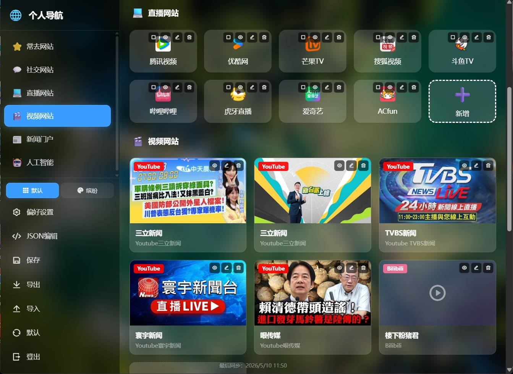
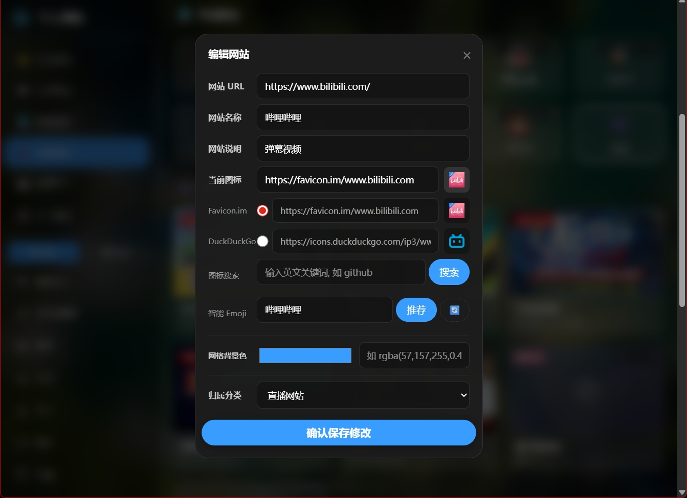
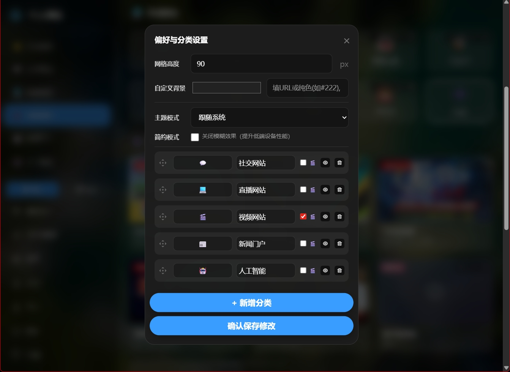

# 🧭 CloudNav - 極簡高效的個人網站導航

<div align="center">


**基於 Cloudflare Pages 和 Workers KV 構建的純雲端、無服務器個人導航頁。**<br>
零代碼基礎，全程使用 Google Gemini 問答和生成代碼，採用響應式毛玻璃（Glassmorphism）卡片設計，原生 JavaScript 開發，0 成本 5 分鐘極速部署。

[👉 在線預覽 Demo ，登錄後臺密碼 123456  👈](https://cloudflare-nav-demo.pages.dev)

</div>

## 📸 界面預覽

<table style="width: 100%; border-collapse: collapse; border: none;">
  <tr style="border: none;">
    <td align="center" style="border: none; width: 50%;">
      
      <br>
      <sub><b>✨ 首頁頁面預覽</b></sub>
    </td>
    <td align="center" style="border: none; width: 50%;">
      
      <br>
      <sub><b>⚙️ 後臺管理頁面預覽</b></sub>
    </td>
  </tr>
  <tr style="border: none;">
    <td align="center" style="border: none; width: 50%;">
      
      <br>
      <sub><b>➕ 網址條目新增頁面預覽</b></sub>
    </td>
    <td align="center" style="border: none; width: 50%;">
      
      <br>
      <sub><b>📁 分類管理頁面預覽</b></sub>
    </td>
  </tr>
</table>

---

## ✨ 核心特性

### 🚀 極速輕量
- 純原生 HTML/CSS/JS 開發，無冗餘前端框架
- 無需 Webpack/Vue/React 構建，直接部署源文件
- 絲滑流暢的交互體驗，首屏加載快

### 🎨 現代 UI 設計
- 採用高級毛玻璃（Glassmorphism）視覺效果
- 半透明卡片背景 + 模糊濾鏡，視覺層次分明
- **左側導航欄** + 連續滾動主內容區，導航體驗更流暢
- 6 列網格佈局（自適應 5/4/3 列響應式斷點）
- 懸停上浮動畫，交互反饋細膩
- 支持**亮色/暗色主題**自動切換和手動切換
- 支持簡約模式（關閉毛玻璃效果，提升低端設備性能）

### 🖼️ 雙模式視圖
- **默認模式（Style 0）**：經典圖標網格，緊湊高效
- **繽紛模式（Style 2）**：列表詳情 + 用戶自定義背景色，信息更豐富
- 側邊欄底部一鍵切換視圖風格

### 🛠️ 純雲端無服務器
- 完美接入 Cloudflare Pages + KV 數據庫
- **零服務器成本**，免去繁瑣運維
- 全球 CDN 加速，訪問速度有保障
- Serverless 架構，按需自動伸縮

### 🖼️ 動態每日壁紙
- 自動拉取 Bing 每日高清壁紙
- 搭配半透明暗色遮罩，確保文字清晰可讀
- 12 小時緩存機制，減少重複請求
- 支持自定義背景圖片 URL 或純色背景

### 📱 完美響應式與 PWA
- 自動適配 PC 端與移動端屏幕
- 移動端側邊欄變為滑出式抽屜，點擊漢堡菜單打開
- 支持 PWA 離線緩存，可像原生 App 一樣添加到桌面
- 斷網也能正常訪問已緩存的頁面

### 🔐 安全內置後臺
- 安全 Token 鑑權（SHA-256 哈希存儲，密碼不洩露）
- 支持在線可視化增刪改查分類與書籤
- 支持鼠標/手指**拖拽排序**（網站卡片 + 視頻卡片均支持）
- 敏感數據（隱藏的分類/書籤）對普通遊客不可見
- 支持**批量選擇**與批量刪除/移動操作

### 🎬 視頻導航
- 自動識別 **Bilibili** 和 **YouTube** 視頻鏈接
- 視頻分類以大卡片網格展示，含封面圖、平臺標識
- 點擊視頻卡片彈出內嵌播放器，無需跳轉頁面
- 視頻彈窗**僅關閉按鈕可退出**，避免誤觸關閉
- 管理員模式下視頻卡片支持**拖拽排序**
- 封面加載失敗自動降級為圖標佔位

### 💻 JSON 數據編輯器
- 內置 **Monaco Editor**（VS Code 同款編輯器）
- 可直接在線編輯原始 JSON 數據，適合高級用戶批量修改
- 支持一鍵格式化、保存

### 🤖 智能圖標獲取
- 內置 Favicon.im 和 DuckDuckGo 接口
- 填入網址自動智能抓取網站圖標
- 支持 Iconify 圖標庫搜索
- 支持 Emoji 圖標作為備選
- 圖標加載失敗時自動回退到隨機 Emoji

### 📊 智能"常去"分類
- 自動記錄每個書籤的點擊次數
- 根據訪問頻次智能生成"常去網站"分類
- 默認展示你最常訪問的 Top 12 網站

### 💾 數據安全與便攜
- 支持一鍵**導出配置**（JSON 格式）
- 支持從文件**導入配置**
- 支持一鍵**恢復默認**配置

---

## 💻 技術棧

| 層級 | 技術 |
|------|------|
| **前端視圖** | HTML5, CSS3, ES6 Vanilla JavaScript |
| **後端 API** | Cloudflare Pages Functions (`functions/api/config.js`) |
| **數據存儲** | Cloudflare Workers KV |
| **靜態資源** | Cloudflare Pages (全球 CDN) |
| **第三方庫** | [SortableJS](https://github.com/SortableJS/Sortable) - 拖拽排序 |
| **第三方庫** | [RemixIcon](https://remixicon.com/) - 開源精美字體圖標 |
| **第三方庫** | [Iconify](https://iconify.design/) - 圖標搜索服務 |
| **第三方庫** | [Monaco Editor](https://microsoft.github.io/monaco-editor/) - 在線代碼編輯器 |

---

## 📂 目錄結構

```text
cloudflare-nav/
├── public/                           # 靜態前端資源 (Pages 部署的根目錄)
│   ├── assets/                       # 輔助資源
│   │   ├── css/
│   │   │   └── style.css             # 核心樣式（設計系統 + 響應式 + 主題）
│   │   ├── js/
│   │   │   ├── app.js                # 核心前端邏輯（導航渲染、管理、視頻、Monaco）
│   │   │   ├── utils.js              # 通用工具函數 (escapeHTML, debounce, emoji)
│   │   │   ├── emoji-pool.js         # Emoji 資源池
│   │   │   └── colorExtractor.js     # 顏色提取工具（繽紛模式）
│   │   └── img/                      # 項目預覽圖或 UI 圖片
│   │       └── preview/              # 項目預覽截圖
│   ├── index.html                    # 純淨的 HTML 入口
│   ├── manifest.json                 # PWA 配置文件
│   └── ServiceWorker.js              # PWA 核心腳本 (緩存策略)
├── functions/                        # 後端 Serverless API
│   └── api/
│       ├── config.js                 # API 處理邏輯 (GET/POST/DELETE)
│       └── defaultData.js            # 默認初始化數據
├── .gitattributes                    # Git 屬性配置
└── README.md                         # 項目文檔
```

---

## 🎨 設計系統

### 佈局架構
- **左側導航欄**（250px 寬度）：分類導航 + 風格切換 + 管理操作
- **主內容區**：連續滾動的分類區塊，最大寬度 62rem (992px)
- **卡片網格**：6 列 → 5 列 → 4 列 → 3 列，響應式斷點分別為 1200px / 900px / 600px

### 主題系統
| 主題 | 說明 |
|------|------|
| 暗色主題 | 默認深色毛玻璃風格 |
| 亮色主題 | 溫和柔光風格，柔和不刺眼 |
| 跟隨系統 | 根據 OS 偏好自動切換亮暗 |
| 簡約模式 | 關閉 backdrop-filter 毛玻璃效果 |

### 視圖模式
| 模式 | 說明 |
|------|------|
| 默認模式（Style 0） | 經典圖標 + 文字卡片網格 |
| 繽紛模式（Style 2） | 橫排列表卡片，支持自定義背景色 |

---

## 🚀 部署指南 (Cloudflare Pages)

**完全免費，整個部署過程不超過 10 分鐘！**

### 準備工作

1. **註冊 Cloudflare 賬號**：訪問 [dash.cloudflare.com](https://dash.cloudflare.com/) 註冊
2. **準備 GitHub 倉庫**：將項目代碼上傳到你的 GitHub 倉庫

### 第一步：上傳到 GitHub

1. 登錄 GitHub，新建一個倉庫（例如 `my-nav`）
2. 將本地 `cloudflare-nav` 文件夾內容上傳到該倉庫
3. 或者直接 Fork 本項目到你的 GitHub 賬戶

### 第二步：創建 Cloudflare 項目

1. 登錄 [Cloudflare 控制檯](https://dash.cloudflare.com/)
2. 在左側菜單找到 **Workers & Pages** → 點擊 **創建應用程序 (Create application)**
3. 切換到 **Pages** 標籤頁 → 點擊 **連接到 Git (Connect to Git)**
4. 授權 GitHub 並選擇你剛剛準備好的倉庫
5. **構建設置 (Build Settings)**：
   - 框架預設 (Framework preset): `None`（重要！）
   - 構建命令 (Build command): *(留空)*
   - 構建輸出目錄 (Build output directory): `public`
6. 點擊 **保存並部署 (Save and Deploy)** 按鈕

### 第三步：配置 KV 數據庫

> 這是數據存儲的核心，必須配置！

1. 回到 Cloudflare 控制檯，進入左側 **Workers & Pages** → **KV**
2. 點擊 **創建命名空間 (Create a namespace)**
3. 輸入名字（例如 `my_nav_db`），點擊確認創建
4. **注意**：記下這個 KV 名字，後面會用到

### 第四步：綁定 KV 到 Pages 項目

1. 進入你剛才部署好的 Pages 項目詳情頁
2. 點擊 **設置 (Settings)** 選項卡
3. 找到 **Functions** → **KV 命名空間綁定 (KV namespace bindings)**
4. 點擊 **綁定變量 (Bind variable)**：
   - **變量名稱 (Variable name)**：必須填入 `nav`（這是代碼中硬編碼的變量名）
   - **KV 命名空間**：選擇你剛才創建的數據庫（如 `my_nav_db`）
5. 點擊 **保存 (Save)** 按鈕

### 第五步：設置管理員密碼

> 這是一個重要的安全步驟，用於保護你的後臺管理功能

1. 在項目設置頁面，找到 **環境變量 (Environment variables)**（在 Functions 下方）
2. 點擊 **添加變量 (Add variable)**：
   - **變量名稱**：必須填入 `TOKEN`（這是代碼中硬編碼的變量名）
   - **值 (Value)**：填入你想要的後臺登錄密碼（例如 `mypassword123`）
3. ⚠️ **建議**：點擊右側的 `加密` 按鈕將密碼加密存儲
4. 點擊 **保存 (Save)** 按鈕

> **注意**：密碼建議使用強密碼，包含字母、數字、特殊字符，長度不少於 8 位。

### 第六步：重新部署生效

1. 返回到項目的 **部署 (Deployments)** 頁面
2. 找到最新的一次部署記錄
3. 點擊最右側的三個點 `...` → **重試部署 (Retry deployment)**
4. 等待部署完成後，點擊系統分配的域名即可訪問！

---

## 🎮 使用說明

### 首次訪問

1. 打開 Cloudflare 分配給你的域名
2. 你將看到默認的導航頁面，包含預設的分類和書籤

### 進入後臺管理

1. 點擊**左側導航欄底部**的 **"管理"** 按鈕
2. 彈出登入框，輸入你在環境變量中設置的 `TOKEN` 密碼
3. 點擊登入即可進入管理模式
4. 登入後管理選單預設隱藏，點擊左下角最大化按鈕即可展開或收合

### 管理員功能

| 功能 | 操作說明 |
|------|----------|
| **新增書籤** | 在對應分類下點擊虛線框的 **"新增"** 卡片 |
| **編輯書籤** | 點擊書籤右上角的 ✏️ 編輯圖標 |
| **刪除書籤** | 點擊書籤右上角的 🗑️ 刪除圖標 |
| **隱藏書籤** | 點擊書籤右上角的 👁️ 眼睛圖標（隱藏後普通用戶看不到） |
| **拖拽排序** | 管理員模式下按住卡片拖動調整順序（網站卡片 & 視頻卡片均支持） |
| **批量操作** | 點擊書籤右上角的 ☑️ 批量選擇按鈕，支持批量刪除和移動 |
| **播放視頻** | 點擊視頻卡片彈出內嵌播放器（僅關閉按鈕可退出彈窗） |
| **切換視圖** | 在側邊欄底部點擊 **"預設"** / **"繽紛"** 切換風格 |
| **切換主題** | 點擊網站標題右側的亮色/暗色切換按鈕 |
| **管理選單** | 登入後預設隱藏，點擊左下角最大化/最小化按鈕展開或收合 |
| **新增分類** | 進入管理模式後，點擊 **"偏好設置"** → **"+ 新增分類"** |
| **編輯分類** | 在偏好設置中修改分類名稱和圖標 |
| **隱藏分類** | 在偏好設置中點擊分類右側的眼睛圖標 |
| **刪除分類** | 在偏好設置中點擊分類右側的刪除圖標（會同時刪除該分類下所有書籤） |
| **調整分類順序** | 在偏好設置中拖拽分類卡片調整順序 |
| **設置卡片寬度** | 在偏好設置中調整"網格寬度"數值 |
| **自定義背景** | 在偏好設置中填入圖片 URL 或純色（如 `#222`），留空使用 Bing 壁紙 |
| **JSON 編輯** | 點擊 **"JSON編輯"** 使用 Monaco Editor 直接編輯原始數據 |
| **導出配置** | 點擊 **"導出"** 按鈕下載 JSON 備份文件 |
| **導入配置** | 點擊 **"導入"** 按鈕從 JSON 文件恢復 |
| **恢復預設** | 點擊 **"預設"** 按鈕恢復初始配置 |
| **退出管理** | 點擊 **"登出"** 按鈕退出管理模式 |

### 遊客視圖 vs 管理員視圖

- **普通遊客**：只能看到未隱藏的分類和書籤
- **管理員**：可以看到所有內容，包括隱藏的分類和書籤，並進行編輯操作

### 視頻導航說明

當分類被標記為**視頻分類**時，該分類下的書籤會以視頻卡片形式展示：

- **Bilibili 視頻**：自動顯示封面圖、Bilibili 標識，支持內嵌播放
- **YouTube 視頻**：自動顯示封面圖、YouTube 標識，支持內嵌播放
- **其他鏈接**：以普通卡片展示，點擊在新窗口打開
- **彈窗播放**：點擊視頻卡片彈出播放器，**只能通過右上角關閉按鈕退出**
- **拖拽排序**：管理員模式下視頻卡片可拖拽調整順序

---

## ⚙️ 進階配置

### 綁定自定義域名（可選）

1. 在 Cloudflare 控制檯進入你的 Pages 項目
2. 點擊 **自定義域 (Custom domains)**
3. 輸入你已有的域名，按照提示配置 DNS 記錄

### 開啟 HTTPS

- Cloudflare Pages 默認自動提供 HTTPS
- 如果綁定自定義域名，確保 Cloudflare 自動簽發 SSL 證書

### 性能優化

- Cloudflare 會自動緩存靜態資源
- 可以在 Cloudflare 控制檯配置頁面規則優化緩存策略
- 低端設備可開啟**簡約模式**，關閉毛玻璃效果提升渲染性能

---

## 📄 開源協議

本項目採用 [MIT License](LICENSE) 開源協議。

---

## 🙏 致謝

- [SortableJS](https://github.com/SortableJS/Sortable) - 拖拽排序功能
- [RemixIcon](https://remixicon.com/) - 精美的圖標字體
- [Iconify](https://iconify.design/) - 豐富的圖標搜索服務
- [Monaco Editor](https://microsoft.github.io/monaco-editor/) - 在線代碼編輯器
- [Favicon.im](https://favicon.im/) - 智能 favicon 獲取
- [Bing](https://www.bing.com/) - 每日高清壁紙
